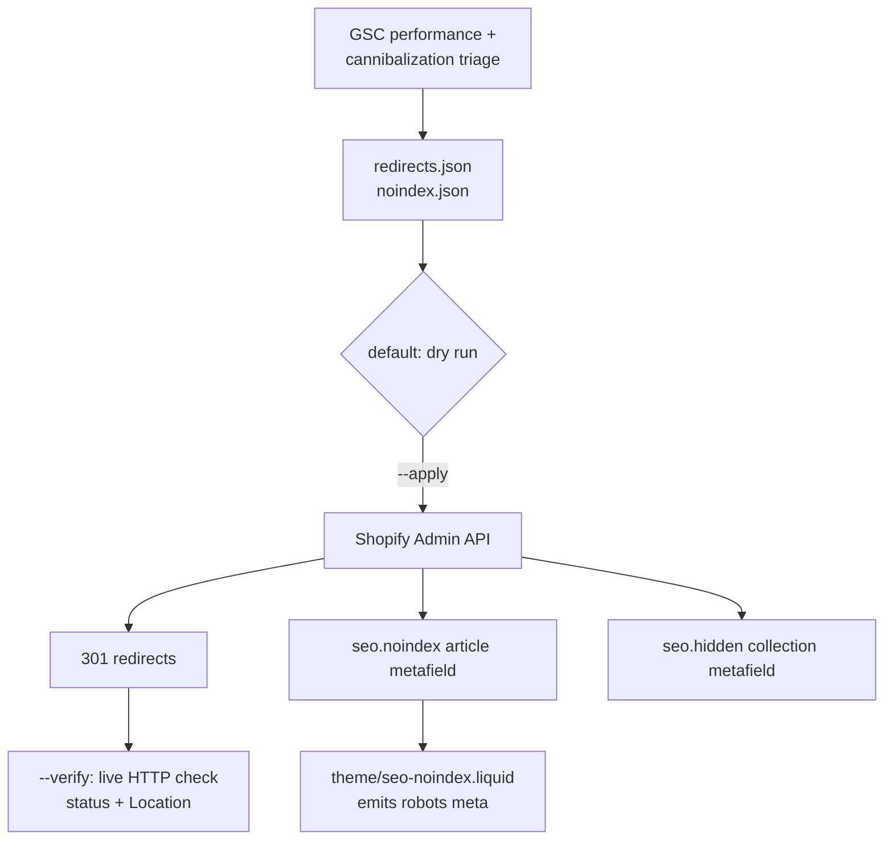

# Shopify SEO Consolidation Scripts

Three Shopify Admin API scripts that clean up a store's index footprint: bulk 301 redirects for cannibalised and duplicate pages, `noindex` on low-value blog articles, and `seo.hidden` on thin collections. Each one previews by default and makes no changes until given `--apply`.

## Problem

Over a few years of publishing, the store's blog had built up several posts competing for the same queries, Shopify `-copy` duplicate products, and collections with only one or two products. These pages split ranking signals and used up crawl budget, and they made up much of Search Console's "Crawled – currently not indexed" report. Fixing them in the Shopify admin means clicking through one page at a time, it leaves no record of what changed or why, and it can't be undone in bulk.

## What it does

| Script | Action | API |
|---|---|---|
| `src/shopify-redirects.js` | Creates 301s from a reviewed JSON map (`path → target` plus a reason). Can list existing redirects, HTTP-verify each one against the live storefront, and prune stale redirects that aren't in the map. | REST `redirects.json` |
| `src/shopify-noindex.js` | Sets an `seo.noindex` metafield on chosen blog articles; the theme snippet then emits `<meta name="robots" content="noindex, follow">`. Has list and full-revert modes. | REST article metafields |
| `src/noindex-thin-collections.js` | Finds every custom and smart collection with fewer than `MIN_PRODUCTS` products and sets Shopify's built-in `seo.hidden = 1`, which adds noindex and drops the page from `sitemap.xml` with no theme change. Records what it hid in a local state file. | GraphQL `collections`, `metafieldsSet` |
| `theme/seo-noindex.liquid` | Head snippet covering the cases redirects can't handle: flagged articles, tag archives, pagination, search, cart and account pages, filter and variant parameter URLs. | Liquid |

## How it works



## Design decisions

- **Auth**: a Shopify custom-app Admin API access token (`X-Shopify-Access-Token`), read from `.env`. It needs no OAuth install flow and its scopes can be kept narrow.
- **Dry run by default**: every script previews unless it is given `--apply`. The destructive stale-redirect cleanup needs `--delete-dupes --confirm`.
- **Idempotent**: before writing, the scripts fetch existing redirects (paginated via the `Link` header) and skip paths already present, comparing case-insensitively. A Shopify "path already taken" response is treated as a skip, not an error. Metafields are checked before they are set. Re-running any script is safe.
- **Reversible where it ran**: `--remove-all` deletes the article metafields the tool set. Collections hidden by `noindex-thin-collections.js` are recorded in its state file, so there is an exact list of what the tool changed.
- **Rate limits**: requests are spaced 300–600 ms apart to stay under the REST leaky bucket (about 2 req/s on standard plans).
- **Data, not code**: the redirect and noindex lists are reviewed JSON inputs with a `reason` on each entry, so every change can be audited and the scripts work on any store. The redirect map is validated on load (leading `/`, target present, path ≠ target).
- **Verify against reality**: `--verify` requests each old path on the storefront with `redirect: 'manual'` and checks both the status code and the `Location` target. A redirect that exists in the admin but isn't live shows up as a 200 or a 404.
- **Native over custom where possible**: collections use Shopify's built-in `seo.hidden`, which the platform respects in both robots meta and the sitemap. The custom `seo.noindex` metafield plus Liquid snippet is used only for articles, where Shopify has no equivalent.

## Setup

```bash
npm install
cp .env.example .env                     # store domain, admin token, blog ID, storefront URL
cp redirects.example.json redirects.json # edit with your own map
cp noindex.example.json noindex.json     # edit with article handles

npm run redirects:preview      # dry run
npm run redirects:apply
npm run redirects:verify       # after Shopify has propagated (minutes)
node src/shopify-redirects.js --list
node src/shopify-redirects.js --delete-dupes            # shows stale redirects
node src/shopify-redirects.js --delete-dupes --confirm  # deletes them

npm run noindex:preview && npm run noindex:apply
npm run collections:preview && npm run collections:apply
```

Paste `theme/seo-noindex.liquid` into `layout/theme.liquid` before `</head>` so the article metafield takes effect. Requires Node 18+.

---

Extracted from a production SEO pipeline I built for a live e-commerce business, 2026.

© Michael Wootan. Source shared for portfolio review; all rights reserved.
